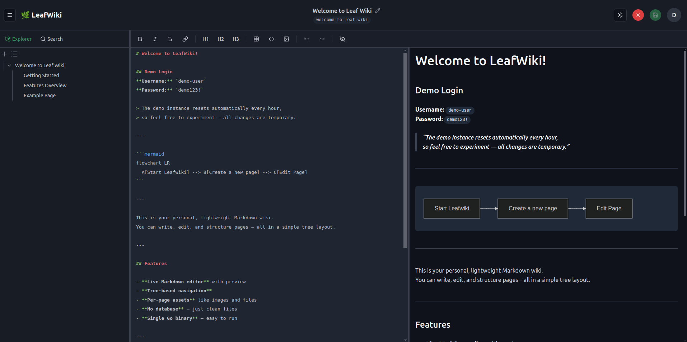
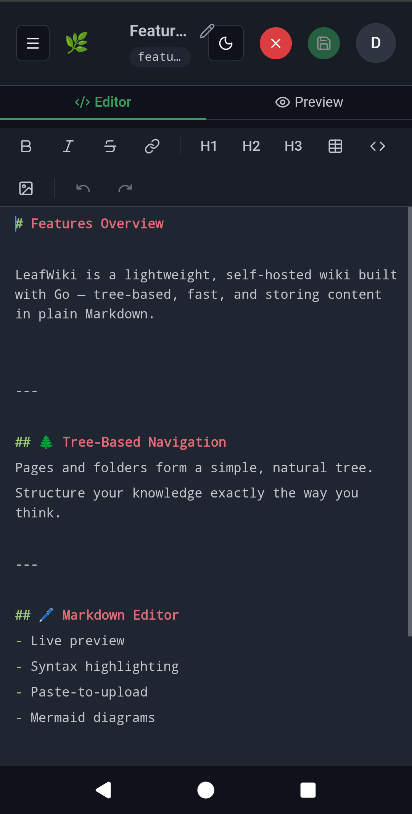
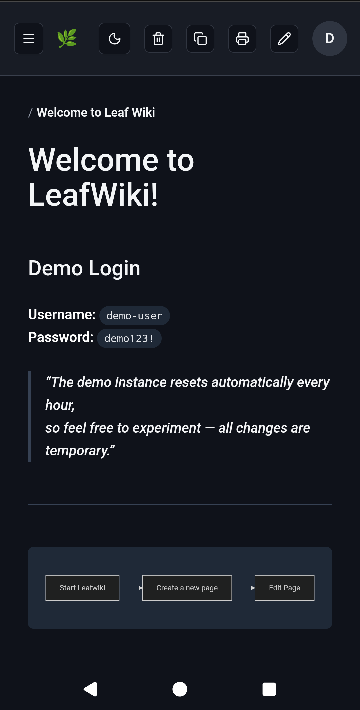
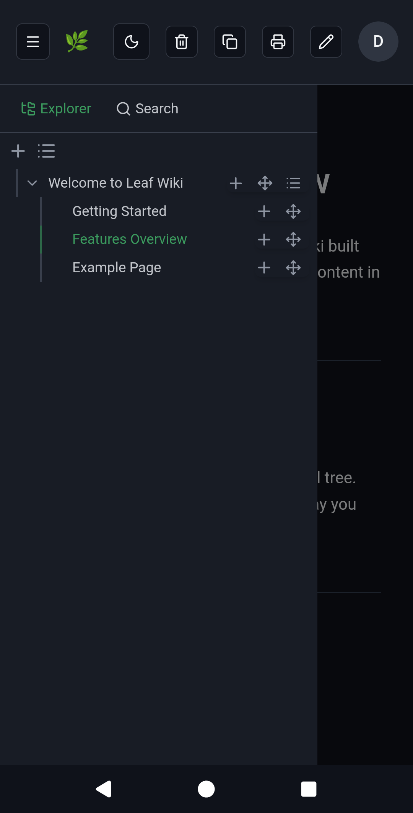
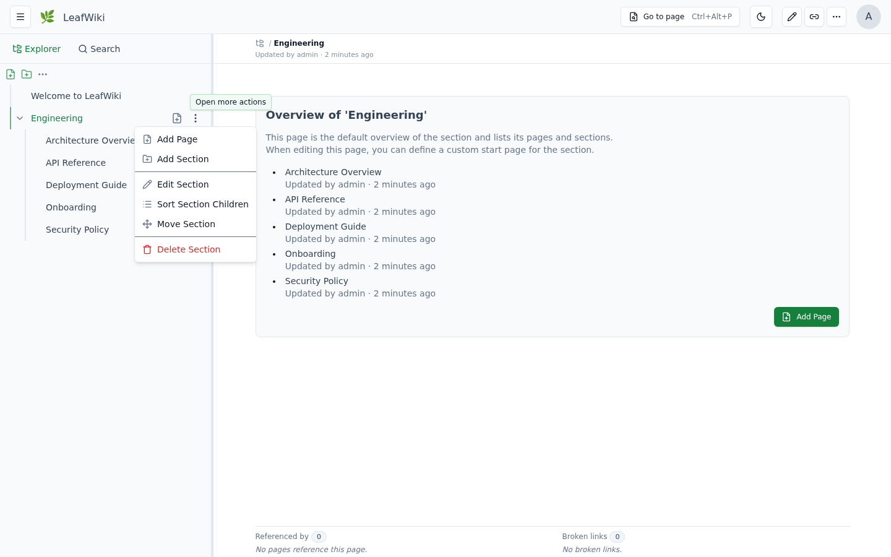
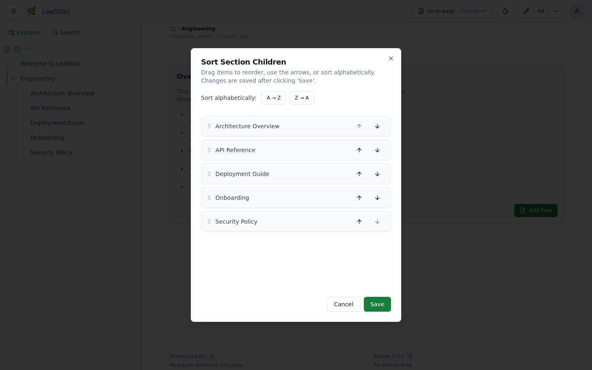

# 🌿 LeafWiki

Self-hosted wiki. Single Go binary. SQLite + Markdown stored on disk.

For engineers and self-hosters who want structured, long-lived documentation. No Node.js, no Redis, no Postgres — just a binary and a data directory.



If you've looked at Wiki.js or Outline and thought "this is too much to operate for what I need" — this could fit for you.

→ Try it without installing: **[demo.leafwiki.com](https://demo.leafwiki.com)** · `Ctrl+E` edit · `Ctrl+S` save · resets hourly  
```bash
docker run -p 8080:8080 -v ~/leafwiki-data:/app/data \
  ghcr.io/perber/leafwiki:latest \
  --jwt-secret=yoursecret --admin-password=yourpassword --allow-insecure=true
```

→ [All install options](#install) (Docker, Docker Compose, Kubernetes, binary)

---

## Table of Contents

- [Features](#features)
- [Good fit / not a fit](#good-fit--not-a-fit)
- [Install](#install)
  - [Docker](#docker)
  - [Docker Compose](#docker-compose)
  - [Kubernetes](#kubernetes)
  - [Binary](#binary)
  - [Reset admin password](#reset-admin-password)
  - [Restore a snapshot (offline)](#restore-a-snapshot-offline)
- [Operating Modes](#operating-modes)
- [Dev Setup](#dev-setup)
- [Configuration](#configuration)
  - [CLI Flags](#cli-flags)
  - [Environment Variables](#environment-variables)
  - [Custom Stylesheet](#custom-stylesheet)
  - [Reverse-Proxy Authentication](#reverse-proxy-authentication)
  - [Unix Socket (v0.11.3)](#unix-socket-v0113)
  - [Email (SMTP)](#email-smtp)
  - [Security](#security)
  - [Operations notes](#operations-notes)
- [Keyboard Shortcuts](#keyboard-shortcuts)
- [External Edits & Resync](#external-edits--resync)
- [Sorting Pages](#sorting-pages)
- [Contributing](#contributing)

---

## Features

**Operations:**
- Single Go binary — no external database, no runtime dependencies
- Markdown on disk — page content is readable outside the app, backup is `cp -r` (stop the app first)
- Runs on Linux, macOS, Windows, Raspberry Pi (x86_64 and ARM64; 32-bit x86 Linux via standalone binary)
- Reverse-proxy friendly with `--base-path`
- Reverse-proxy authentication via trusted HTTP header (v0.10+)
- API keys for programmatic and agent access, admin-managed, scoped by role — in development, not yet ready for use
- Three access modes: fully internal, public read with login-only editing, or open editing without login (see [Operating Modes](#operating-modes))
- Roles: admin, editor, viewer

**Core functionality:**
- Tree navigation — explicit hierarchy, not flat note feeds
- Manual page ordering — sort order is explicit, not driven by filename (see [Sorting Pages](#sorting-pages))
- Full-text search across titles and content, with tag-based filtering
- Tags on pages — searchable and filterable across the wiki
- Backlinks and link status per page (incoming, outgoing, broken links), with a dedicated admin view for auditing broken links
- Built-in Markdown editor with live preview, keyboard shortcuts, and autocomplete for internal page links
- Optimistic locking for concurrent edits
- Markdown: tables, task lists, footnotes, callouts (`:::info` / `:::warning`), collapsible blocks (`:::collapsible` / `:::collapsed`), Mermaid diagrams, KaTeX math blocks (`$$...$$`, inline `$...$` not supported), sanitized inline HTML, embedded PDFs (``, optionally opened on a specific page with ``)

**Customization:**
- Custom stylesheet (`--custom-stylesheet`, v0.8.5+)
- Inject HTML/JS into `<head>` for analytics or custom CSS
- Branding: logo, favicon, site name
- Dark mode and mobile-friendly UI
- Translated UI — ships in English, German, and Spanish; `--default-language` picks the default. Contributions of other languages are very welcome — see [docs/i18n.md](docs/i18n.md)

**Opt-in via feature flags:**
- Revision history (`--enable-revision`)
- Automatic link rewriting when pages are renamed or moved (`--enable-link-refactor`)
- Email via SMTP for password reset and user invitations (`--smtp-host`, v0.13.0)

**Markdown import:**
- ZIP-based importer for editors and admins
- Supports Obsidian-style wiki link rewriting on import
- Best results with a reasonably clean folder structure; not a fully automatic converter for all source formats

**Mobile:**

<p align="center">
  
  
  
</p>

---

## Good fit / not a fit

**Good fit:**
- Personal wikis, engineering notebooks, and runbooks
- Internal team or homelab documentation
- Existing Markdown or Obsidian vaults that need a structured wiki UI
- Small teams that want tree navigation over flat note feeds
- Self-hosted environments with low operational overhead

**Probably not a fit:**
- Organizations needing complex enterprise permissions or approval workflows
- Real-time collaborative editing
- Teams looking for a Confluence or Notion replacement

LeafWiki is intentionally narrower than those systems. That focus is part of the value.

---

**Prefer not to run your own server?** Free hosted beta — 10 spots, starting September 2026. [Get a beta spot →](https://leafwiki.com/hosted/#waitlist) and help shape the hosted version.

---

## Install

### Docker

```bash
docker run -p 8080:8080 \
    -v ~/leafwiki-data:/app/data \
    ghcr.io/perber/leafwiki:latest \
    --jwt-secret=yoursecret \
    --admin-password=yourpassword \
    --allow-insecure=true
```

`--allow-insecure=true` is required for plain HTTP. Omit it when serving over HTTPS (make sure your reverse proxy forwards `X-Forwarded-Proto: https`).

**Non-root:**

```bash
docker run -p 8080:8080 \
    -u 1000:1000 \
    -v ~/leafwiki-data:/app/data \
    ghcr.io/perber/leafwiki:latest \
    --jwt-secret=yoursecret \
    --admin-password=yourpassword \
    --allow-insecure=true
```

The data directory must be writable by the specified user.

### Docker Compose

```yaml
services:
  leafwiki:
    image: ghcr.io/perber/leafwiki:latest
    container_name: leafwiki
    user: 1000:1000
    ports:
      - "8080:8080"
    environment:
      - LEAFWIKI_JWT_SECRET=yourSecret
      - LEAFWIKI_ADMIN_PASSWORD=yourPassword
      - LEAFWIKI_ALLOW_INSECURE=true  # Required for plain HTTP. Omit for HTTPS (ensure `X-Forwarded-Proto: https` is forwarded).
    volumes:
      - ${HOME}/leafwiki-data:/app/data
    restart: unless-stopped
```

### Kubernetes

See [docs/install/kubernetes.md](docs/install/kubernetes.md) for a `Deployment` + `PersistentVolumeClaim` + `Service` + `Ingress` example (Gateway API alternative included).

### Binary

Place the `leafwiki-<version>-<os>-<arch>` executable and its `.sha256` checksum
file in the current directory. Verify the checksum, then rename the executable
to `leafwiki`:

```bash
sha256sum leafwiki-<version>-<os>-<arch>
cat leafwiki-<version>-<os>-<arch>.sha256
mv leafwiki-<version>-<os>-<arch> leafwiki
chmod +x leafwiki
./leafwiki --jwt-secret=yoursecret --admin-password=yourpassword --allow-insecure=true
```

The server binds to `127.0.0.1:8080` by default. To expose it on the network:

```bash
./leafwiki --jwt-secret=yoursecret --admin-password=yourpassword --host=0.0.0.0 --allow-insecure=true
```

Default data directory is `./data`. Change with `--data-dir`.

> 32-bit x86 Linux (i686, e.g. Alpine on an Intel Atom) is supported on a best-effort basis: use the `linux-386` binary. It is built without CGO, so it doesn't need glibc and runs on musl-based distros. Docker images only cover amd64/arm64, so the standalone binary is the install path on 32-bit x86.

### Build from source

Requires Go and Node.js (versions: the `toolchain` line in `go.mod`, and `.nvmrc`). `make build` compiles the UI, embeds it, and produces a self-contained `leafwiki` binary (same as release/Docker builds). Use HTTP (`http://localhost:8080/`), not HTTPS, unless you terminate TLS in front of LeafWiki.

```bash
git switch --detach v0.13.0   # or any tag / main
make build
./leafwiki --disable-auth --host=127.0.0.1 --data-dir ./data --allow-insecure=true
```

For API-only local development with Vite, use `make build-api` (or `make run`) instead — see [Dev Setup](#dev-setup).

### Reset admin password

```bash
./leafwiki reset-admin-password
```

### Restore a snapshot (offline)

For disaster recovery or migrating to a fresh instance, restore a snapshot ZIP into the data directory while the server is stopped:

```bash
./leafwiki --data-dir ./data restore-snapshot ./data/snapshots/leafwiki-snapshot-2026-01-01.zip
```

When `--snapshot` is enabled, a live restore is also available from the admin UI (Settings → Full Backup). Use this offline command when the server can't start or you're seeding a new data directory. The `--snapshot*` flags are in [CLI Flags](#cli-flags).

---

## Operating Modes

LeafWiki supports three access modes. Pick the one that matches your environment:

### 1. Internal wiki — login required (default)

All access requires authentication. Nobody can read or edit without a valid account. This is the default behavior when no access flags are set.

```bash
./leafwiki --jwt-secret=yoursecret --admin-password=yourpassword
```

Use this for team-internal wikis or homelab setups where content should stay private.

### 2. Public read, login required for editing

Anyone can browse the wiki without logging in. Only authenticated users with an editor or admin role can make changes.

```bash
./leafwiki --jwt-secret=yoursecret --admin-password=yourpassword --public-access=true
```

Use this for open documentation or project wikis where readers don't need accounts, but you still want to control who can edit.

### 3. No login — everyone can read and edit (`--disable-auth`)

Authentication is completely disabled. Anyone who can reach the server can read and edit all pages.

```bash
./leafwiki --disable-auth --host=127.0.0.1
```

> ⚠️ Only use this on trusted internal networks or local setups. Never expose a `--disable-auth` instance to the public internet.

---

## Dev Setup

**Stack:** Go · React (Vite) · SQLite

```bash
```

```bash
mise install   # optional: Node from .nvmrc and Go; nvm/fnm and any Go >= 1.21 work too
make setup     # npm dependencies
make dev       # backend + Vite; Ctrl-C stops both
```

Vite starts on `http://localhost:5173` (login `admin` / `devpassword`) and proxies the API to
the backend on `127.0.0.1:8080`. `make doctor` checks your Go and Node versions.
No local toolchain? The [Dev Container](.devcontainer/devcontainer.json) sets everything up in
VS Code; then run `make dev`.

See [CONTRIBUTING.md](CONTRIBUTING.md#development-setup) for running the two separately and for contribution guidelines.

---

## Configuration

### Required

| Flag | Description |
|------|-------------|
| `--jwt-secret` | Secret for signing JWTs. Keep it secure. |
| `--admin-password` | Initial admin password (only applied if no admin exists yet). |

### Optional admin identity

| Flag | Description | Default |
|------|-------------|---------|
| `--admin-username` | Initial admin username (only applied if no admin exists yet). | `admin` |
| `--admin-email` | Initial admin email (only applied if no admin exists yet). | `admin@localhost` |

For plain HTTP: add `--allow-insecure=true` so login and CSRF cookies work.

### CLI Flags

| Flag                             | Description                                                             | Default       | Since   |
|----------------------------------|-------------------------------------------------------------------------|---------------|---------|
| `--host`                         | Host/IP the server binds to                                             | `127.0.0.1`   | –       |
| `--port`                         | Port the server listens on                                              | `8080`        | –       |
| `--unix-socket`                  | Unix domain socket path; overrides `--host` and `--port`                | `""`          | v0.11.3 |
| `--data-dir`                     | Directory where data is stored                                          | `./data`      | –       |
| `--admin-username`               | Initial admin username (only applied if no admin exists yet)            | `admin`       | v0.12.0 |
| `--admin-email`                  | Initial admin email (only applied if no admin exists yet)               | `admin@localhost` | v0.12.0 |
| `--public-access`                | Allow public read-only access                                           | `false`       | –       |
| `--base-path`                    | URL prefix for reverse proxy setups (e.g. `/wiki`)                      | `""`          | v0.8.2  |
| `--allow-insecure`               | ⚠️ Enables HTTP for auth cookies (required for plain HTTP)              | `false`       | v0.7.0  |
| `--disable-auth`                 | ⚠️ Disable all authentication (internal networks only)                  | `false`       | v0.7.0  |
| `--access-token-timeout`         | Access token duration (e.g. `24h`, `15m`)                               | `15m`         | v0.7.0  |
| `--refresh-token-timeout`        | Refresh token duration (e.g. `168h`)                                    | `168h`        | v0.7.0  |
| `--max-asset-upload-size`        | Max upload size (e.g. `50MiB`, `52428800`)                              | `50MiB`       | v0.8.5  |
| `--custom-stylesheet`            | Path to a `.css` file inside the data dir                               | `""`          | v0.8.5  |
| `--default-language`             | Default UI language code (`en`, `de`, `es`)                             | `""`          | v0.13.0 |
| `--inject-code-in-header`        | Raw HTML/JS injected into `<head>`                                      | `""`          | v0.6.0  |
| `--hide-link-metadata-section`   | Hide backlinks and link status panel                                    | `false`       | –       |
| `--enable-revision`              | Enable revision history                                                 | `false`       | v0.9.0  |
| `--enable-link-refactor`         | Enable link rewriting on rename/move                                    | `false`       | v0.9.0  |
| `--max-revision-history`         | Max revisions per page; `0` = unlimited                                 | `100`         | v0.9.0  |
| `--revision-coalesce-window`     | Window for coalescing rapid successive auto-save revisions by the same author; `0` = disabled | `5m` | v0.11.0 |
| `--enable-http-remote-user`      | Enable reverse-proxy auth via HTTP header                               | `false`       | v0.10.0 |
| `--http-remote-user-header-name` | Header name carrying the username or email from the proxy               | `Remote-User` | v0.10.0 |
| `--enable-http-remote-user-auto-create` | Auto-provision users the proxy asserts but LeafWiki doesn't know    | `false`    | v0.12.1 |
| `--http-remote-user-email-header-name` | Header name carrying the email for auto-created users               | `""`        | v0.12.1 |
| `--http-remote-user-default-role` | Role assigned to auto-created users; must not be `admin`               | `viewer`      | v0.12.1 |
| `--trusted-proxy-ips`            | Trusted proxy IPs/CIDRs for remote-user header                          | `""`          | v0.10.0 |
| `--login-url`                    | Redirect to an external URL instead of the built-in login form          | `""`          | v0.12.0 |
| `--logout-url`                   | Redirect to an external URL after logout                                | `""`          | v0.12.0 |
| `--http-remote-user-logout-url`  | ⚠️ Deprecated, use `--logout-url` instead                               | `""`          | v0.10.0 |
| `--user-management-url`          | Replace the built-in User Management UI with a link to an external page  | `""`          | v0.11.4 |
| `--disable-request-log`          | Suppress per-request HTTP access log lines                              | `false`       | v0.10.1 |
| `--log-format`                   | Log output format: `text` or `json`                                     | `text`        | v0.12.0 |
| `--enable-metrics`               | Enable the Prometheus `/metrics` endpoint on a separate listener        | `false`       | v0.12.0 |
| `--metrics-host`                 | Host/IP for the metrics listener                                       | `127.0.0.1`   | v0.12.0 |
| `--metrics-port`                 | Port for the metrics listener                                          | `9091`        | v0.12.0 |
| `--snapshot`                     | Enable full backup snapshots (ZIP incl. the SQLite database)           | `true`        | v0.12.0 |
| `--snapshot-interval`            | Snapshot interval (e.g. `24h`, `6h`); `0` = manual-only                 | `24h`         | v0.12.0 |
| `--snapshot-retention`           | Number of most recent snapshots to keep; `<= 0` = keep all             | `10`          | v0.12.0 |
| `--snapshot-dir`                 | Directory to store snapshot ZIPs in                                     | `<data-dir>/snapshots` | v0.12.0 |
| `--restore-upload-max-size`      | Max size for an uploaded backup ZIP to restore from                    | `500MiB`      | v0.12.0 |
| `--smtp-host`                    | SMTP host for password-reset and invite email; unset disables email     | `""`          | v0.13.0 |
| `--smtp-port`                    | SMTP server port                                                        | `587`         | v0.13.0 |
| `--smtp-username`                | SMTP auth username                                                      | `""`          | v0.13.0 |
| `--smtp-password`                | SMTP auth password (prefer env var)                                     | `""`          | v0.13.0 |
| `--smtp-from`                    | From address for outgoing email (required when `--smtp-host` is set)    | `""`          | v0.13.0 |
| `--smtp-from-name`               | From display name for outgoing email                                    | `LeafWiki`    | v0.13.0 |
| `--smtp-security`                | Transport security: `none`, `starttls`, or `tls`                        | `starttls`    | v0.13.0 |
| `--smtp-insecure-skip-verify`    | Skip TLS certificate verification for SMTP (testing only)               | `false`       | v0.13.0 |
| `--smtp-timeout`                 | Timeout for a single SMTP send (e.g. `10s`)                             | `10s`         | v0.13.0 |
| `--public-url`                   | Base URL for links in outgoing email (required when `--smtp-host` is set) | `""`        | v0.13.0 |

> Docker image default: `LEAFWIKI_HOST` is set to `0.0.0.0` automatically by the container entrypoint if neither `--host` nor `LEAFWIKI_HOST` is provided.

### Environment Variables

| Variable                                | Description                                          | Default       | Since   |
|-----------------------------------------|------------------------------------------------------|---------------|---------|
| `LEAFWIKI_HOST`                         | Host/IP address                                      | `127.0.0.1`   | –       |
| `LEAFWIKI_PORT`                         | Port                                                 | `8080`        | –       |
| `LEAFWIKI_UNIX_SOCKET`                  | Unix domain socket path; overrides host/port         | `""`          | v0.11.3 |
| `LEAFWIKI_DATA_DIR`                     | Data directory path                                  | `./data`      | –       |
| `LEAFWIKI_ADMIN_PASSWORD`               | Initial admin password *(required)*                  | –             | –       |
| `LEAFWIKI_ADMIN_USERNAME`               | Initial admin username (only applied if no admin exists yet) | `admin`       | v0.12.0 |
| `LEAFWIKI_ADMIN_EMAIL`                  | Initial admin email (only applied if no admin exists yet) | `admin@localhost` | v0.12.0 |
| `LEAFWIKI_JWT_SECRET`                   | JWT signing secret *(required)*                      | –             | –       |
| `LEAFWIKI_PUBLIC_ACCESS`                | Allow public read-only access                        | `false`       | –       |
| `LEAFWIKI_BASE_PATH`                    | URL prefix for reverse proxy                         | `""`          | v0.8.2  |
| `LEAFWIKI_ALLOW_INSECURE`               | ⚠️ HTTP auth cookies                                 | `false`       | v0.7.0  |
| `LEAFWIKI_DISABLE_AUTH`                 | ⚠️ Disable authentication                            | `false`       | v0.7.0  |
| `LEAFWIKI_ACCESS_TOKEN_TIMEOUT`         | Access token duration                                | `15m`         | v0.7.0  |
| `LEAFWIKI_REFRESH_TOKEN_TIMEOUT`        | Refresh token duration                               | `168h`        | v0.7.0  |
| `LEAFWIKI_MAX_ASSET_UPLOAD_SIZE`        | Max upload size                                      | `50MiB`       | v0.8.5  |
| `LEAFWIKI_CUSTOM_STYLESHEET`            | Path to `.css` file inside data dir                  | `""`          | v0.8.5  |
| `LEAFWIKI_DEFAULT_LANGUAGE`             | Default UI language code (`en`, `de`, `es`)          | `""`          | v0.13.0 |
| `LEAFWIKI_INJECT_CODE_IN_HEADER`        | HTML/JS injected into `<head>`                       | `""`          | v0.6.0  |
| `LEAFWIKI_HIDE_LINK_METADATA_SECTION`   | Hide backlinks and link status panel                 | `false`       | –       |
| `LEAFWIKI_ENABLE_REVISION`              | Revision history                                     | `false`       | v0.9.0  |
| `LEAFWIKI_ENABLE_LINK_REFACTOR`         | Link rewriting on rename/move                        | `false`       | v0.9.0  |
| `LEAFWIKI_MAX_REVISION_HISTORY`         | Max revisions per page; `0` = unlimited              | `100`         | v0.9.0  |
| `LEAFWIKI_REVISION_COALESCE_WINDOW`     | Window for coalescing rapid successive auto-save revisions; `0` = disabled | `5m` | v0.11.0 |
| `LEAFWIKI_ENABLE_HTTP_REMOTE_USER`      | Reverse-proxy auth via header                        | `false`       | v0.10.0 |
| `LEAFWIKI_HTTP_REMOTE_USER_HEADER_NAME` | Username or email header from proxy                  | `Remote-User` | v0.10.0 |
| `LEAFWIKI_ENABLE_HTTP_REMOTE_USER_AUTO_CREATE` | Auto-provision users the proxy asserts but LeafWiki doesn't know | `false` | v0.12.1 |
| `LEAFWIKI_HTTP_REMOTE_USER_EMAIL_HEADER_NAME` | Email header for auto-created users            | `""`          | v0.12.1 |
| `LEAFWIKI_HTTP_REMOTE_USER_DEFAULT_ROLE` | Role assigned to auto-created users; must not be `admin` | `viewer`      | v0.12.1 |
| `LEAFWIKI_TRUSTED_PROXY_IPS`            | Trusted proxy IPs/CIDRs                              | `""`          | v0.10.0 |
| `LEAFWIKI_LOGIN_URL`                    | Redirect to an external URL instead of the login form | `""`          | v0.12.0 |
| `LEAFWIKI_LOGOUT_URL`                   | Redirect to an external URL after logout             | `""`          | v0.12.0 |
| `LEAFWIKI_HTTP_REMOTE_USER_LOGOUT_URL`  | ⚠️ Deprecated, use `LEAFWIKI_LOGOUT_URL` instead     | `""`          | v0.10.0 |
| `LEAFWIKI_USER_MANAGEMENT_URL`          | Replace the built-in User Management UI with an external link | `""`  | v0.11.4 |
| `LEAFWIKI_DISABLE_REQUEST_LOG`          | Suppress per-request HTTP access log lines           | `false`       | v0.10.1 |
| `LEAFWIKI_LOG_FORMAT`                   | Log output format: `text` or `json`                  | `text`        | v0.12.0 |
| `LEAFWIKI_LOG_LEVEL`                    | Log level: `debug`, `info`, `warn`, `error` (env-var only, no CLI flag) | `info` | v0.8.0  |
| `LEAFWIKI_ENABLE_METRICS`               | Enable the Prometheus `/metrics` endpoint            | `false`       | v0.12.0 |
| `LEAFWIKI_METRICS_HOST`                 | Host/IP for the metrics listener                     | `127.0.0.1`   | v0.12.0 |
| `LEAFWIKI_METRICS_PORT`                 | Port for the metrics listener                        | `9091`        | v0.12.0 |
| `LEAFWIKI_SNAPSHOT`                     | Enable full backup snapshots                         | `true`        | v0.12.0 |
| `LEAFWIKI_SNAPSHOT_INTERVAL`            | Snapshot interval; `0` = manual-only                 | `24h`         | v0.12.0 |
| `LEAFWIKI_SNAPSHOT_RETENTION`           | Number of most recent snapshots to keep; `<= 0` = keep all | `10`   | v0.12.0 |
| `LEAFWIKI_SNAPSHOT_DIR`                 | Directory to store snapshot ZIPs in                  | `<data-dir>/snapshots` | v0.12.0 |
| `LEAFWIKI_RESTORE_UPLOAD_MAX_SIZE`      | Max size for an uploaded backup ZIP to restore from  | `500MiB`      | v0.12.0 |
| `LEAFWIKI_SMTP_HOST`                    | SMTP host for password-reset/invite email; unset disables email | `""` | v0.13.0 |
| `LEAFWIKI_SMTP_PORT`                    | SMTP server port                                    | `587`         | v0.13.0 |
| `LEAFWIKI_SMTP_USERNAME`               | SMTP auth username                                   | `""`          | v0.13.0 |
| `LEAFWIKI_SMTP_PASSWORD`               | SMTP auth password                                   | `""`          | v0.13.0 |
| `LEAFWIKI_SMTP_FROM`                    | From address (required with `LEAFWIKI_SMTP_HOST`)   | `""`          | v0.13.0 |
| `LEAFWIKI_SMTP_FROM_NAME`              | From display name                                    | `LeafWiki`    | v0.13.0 |
| `LEAFWIKI_SMTP_SECURITY`               | Transport security: `none`, `starttls`, or `tls`    | `starttls`    | v0.13.0 |
| `LEAFWIKI_SMTP_INSECURE_SKIP_VERIFY`   | Skip TLS certificate verification for SMTP           | `false`       | v0.13.0 |
| `LEAFWIKI_SMTP_TIMEOUT`                | Timeout for a single SMTP send                       | `10s`         | v0.13.0 |
| `LEAFWIKI_PUBLIC_URL`                  | Base URL for links in outgoing email (required with `LEAFWIKI_SMTP_HOST`) | `""` | v0.13.0 |

### Custom Stylesheet

Place a `.css` file inside your data directory and pass its path:

```bash
./leafwiki \
  --data-dir=./data \
  --custom-stylesheet=custom.css \
  --jwt-secret=yoursecret \
  --admin-password=yourpassword
```

- File must exist at `./data/custom.css`
- Served as `/custom.css` (or `${base-path}/custom.css` with `--base-path`)
- The endpoint is publicly accessible

### Reverse-Proxy Authentication

Available since v0.10.0. Use when an upstream proxy authenticates users and forwards the username or email via HTTP header.

```bash
./leafwiki \
  --jwt-secret=yoursecret \
  --admin-password=yourpassword \
  --enable-http-remote-user=true \
  --http-remote-user-header-name=X-Forwarded-User \
  --trusted-proxy-ips=127.0.0.1,172.18.0.0/16 \
  --login-url=https://auth.example.com/login \
  --logout-url=https://auth.example.com/logout
```

- Only trusts the header from IPs listed in `--trusted-proxy-ips`
- If the forwarded username or email doesn't match a LeafWiki user, the request is rejected — unless `--enable-http-remote-user-auto-create` is set (see below)
- Do not enable without configuring `--trusted-proxy-ips`
- `--login-url` and `--logout-url` are independent, optional redirect targets — set either or both to send users to an external IdP instead of the built-in login form / to redirect after logout
- `--login-url`, `--logout-url`, and `--user-management-url` must all start with `http://` or `https://`; the server refuses to start otherwise (relative paths are not accepted for any of them)
- ⚠️ `--login-url` takes effect regardless of `--enable-http-remote-user` and has no in-app bypass: once set, *every* unauthenticated visit (including `/login` itself) redirects to it immediately. Double-check the URL before setting it — a wrong or unreachable value locks all users, including admins, out of the built-in login form
- `--http-remote-user-logout-url` (v0.10.0) is deprecated; use `--logout-url` instead. It still works as a fallback when `--logout-url`/`LEAFWIKI_LOGOUT_URL` isn't set, but a deprecation warning is logged

#### Auto-creating users (v0.12.1)

By default, a proxy-asserted identity with no matching LeafWiki account is rejected (401). Set `--enable-http-remote-user-auto-create=true` to provision one automatically instead:

```bash
./leafwiki \
  --jwt-secret=yoursecret \
  --admin-password=yourpassword \
  --enable-http-remote-user=true \
  --http-remote-user-header-name=X-Forwarded-User \
  --trusted-proxy-ips=127.0.0.1,172.18.0.0/16 \
  --enable-http-remote-user-auto-create=true \
  --http-remote-user-email-header-name=X-Forwarded-Email \
  --http-remote-user-default-role=viewer
```

- Requires `--enable-http-remote-user` to also be set; the server refuses to start otherwise
- The value in `--http-remote-user-header-name` becomes the new account's username verbatim, even if it looks like an email address — if your proxy sends an email in that header and you want a distinct, readable username, point `--http-remote-user-email-header-name` at a separate proxy header
- If `--http-remote-user-email-header-name` isn't set or the header is empty, a non-deliverable placeholder email (`<username>@remote-user.invalid`) is used instead
- Auto-created accounts get a random password nobody is told — they can only ever authenticate via the trusted proxy, not the built-in login form
- `--http-remote-user-default-role` **must not be `admin`** — the server refuses to start otherwise. A forged or misrouted header must not be able to mint an admin account by itself; promote an auto-created user to admin manually if needed

### Unix Socket (v0.11.3)

Use `--unix-socket` when LeafWiki should listen on a local unix domain socket instead of TCP.

```bash
./leafwiki \
  --unix-socket=/run/leafwiki/leafwiki.sock \
  --data-dir=./data \
  --jwt-secret=yoursecret \
  --admin-password=yourpassword
```

- `--unix-socket` overrides `--host` and `--port`
- LeafWiki still serves normal HTTP; a reverse proxy such as Nginx or Caddy connects to the socket
- If a stale socket file exists from a previous run, LeafWiki removes it before listening
- New socket files are created with permissions `0660`
- On Windows, unix sockets are not supported and LeafWiki returns a startup error if this option is used


> **Experimental** — This feature is new and may change in future releases. Test it thoroughly before relying on it for critical data.


Backups run automatically on a configurable interval and can also be triggered manually from the **Git Content Backup** page.

**CLI flags (v0.11.3+):**

| Flag | Description | Default |
|------|-------------|---------|

**Environment variables:**

| Variable | Description |
|----------|-------------|

**Example — SSH (Docker Compose):**

```yaml
environment:
```

**Example — HTTPS with an access token (Docker Compose, v0.13.0+):**

```yaml
environment:
```

On GitHub, create a **fine-grained personal access token** limited to the backup repository with **Contents: Read and write** permission, and use it as the password. The username can be your GitHub username.

**Notes:**

- Prefer `https://` over `http://`: with plain `http://` the credentials and your wiki content travel unencrypted, and LeafWiki logs a warning at startup.
- If the remote diverges (e.g. someone pushed directly to the backup branch), LeafWiki will stop auto-pushing and show a **Conflict — remote diverged** warning in the UI. Click **Force Push** in the UI to overwrite the remote with the current local backup history. Your wiki content is never lost — the local backup repo is always authoritative.
- This backs up **content only** — the SQLite database is not included. For a full backup, use your data directory (`cp -r` with the app stopped).
- When LeafWiki first connects to a remote that already contains a backup, it syncs that content into the local data directory before the wiki loads its pages (local files always win — nothing is overwritten). A new instance therefore picks up the backed-up pages instead of overwriting the remote with an empty wiki, and it does not seed its default welcome page when the backup already has content. After that first sync, backups behave normally, including committing deletions.

---

### Email (SMTP)

Available since v0.13.0. Configure an SMTP server to enable the **forgot-password** flow and **email-based user invitations**. Without `--smtp-host`, both features stay off and the login form shows no password-reset link.

```bash
./leafwiki \
  --jwt-secret=yoursecret \
  --admin-password=yourpassword \
  --smtp-host=smtp.example.com \
  --smtp-port=587 \
  --smtp-security=starttls \
  --smtp-username=leafwiki@example.com \
  --smtp-password=yourpassword \
  --smtp-from=leafwiki@example.com \
  --public-url=https://wiki.example.com
```

- `--smtp-from` and `--public-url` are **required** once `--smtp-host` is set — the server refuses to start otherwise
- `--public-url` must be an absolute `http(s)://` URL; it is the base for links in outgoing email
- `--smtp-security` is one of `none`, `starttls` (default), or `tls`
- Prefer `LEAFWIKI_SMTP_PASSWORD` over the flag to keep the password out of process listings
- `--smtp-insecure-skip-verify` disables TLS certificate verification — for testing only

---

### Security

Enabled by default since v0.7.0:

- Secure, HttpOnly cookies for session handling
- CSRF protection on all state-changing requests
- Rate limiting on auth endpoints
- Role-based access: admin, editor, viewer

**`--disable-auth`** removes all authentication. Only use for local development, trusted internal networks, or isolated environments.

```bash
# Safe local-only example:
./leafwiki --disable-auth --host=127.0.0.1
```

For most setups, prefer `--public-access` for read-only public access and the viewer role for restricted accounts.

### Operations notes

- Default bind: `127.0.0.1` (binary) / `0.0.0.0` (Docker image)
- Default data dir: `./data` (binary) / `/app/data` (container)
- Defaults are intentionally conservative — a fresh install does not become network-exposed by accident

---

## Keyboard Shortcuts

| Action                | Shortcut                               |
|-----------------------|----------------------------------------|
| Shortcuts help        | `Ctrl + /` / `Cmd + /`                 |
| Edit mode             | `Ctrl + E` / `Cmd + E`                 |
| Save                  | `Ctrl + S` / `Cmd + S`                 |
| Search                | `Ctrl + Shift + F` / `Cmd + Shift + F` |
| Navigation pane       | `Ctrl + Shift + E` / `Cmd + Shift + E` |
| Go to page            | `Ctrl + Alt + P` / `Cmd + Option + P`  |
| Toggle TOC            | `Ctrl + Shift + O` / `Cmd + Shift + O` |
| Copy page link        | `Ctrl + Shift + S` / `Cmd + Shift + S` |
| Share / permalink     | `Ctrl + Shift + L` / `Cmd + Shift + L` |
| Page history          | `Ctrl + H` / `Cmd + H`                 |
| Print page            | `Ctrl + P` / `Cmd + P`                 |
| Delete page           | `Ctrl + Delete` / `Cmd + Delete`       |
| Bold                  | `Ctrl + B` / `Cmd + B`                 |
| Italic                | `Ctrl + I` / `Cmd + I`                 |
| Insert link           | `Ctrl + K` / `Cmd + K`                 |
| Headline 1–3          | `Ctrl + Alt + 1–3` / `Cmd + Alt + 1–3` |

`Ctrl+V` / `Cmd+V` for pasting images and files works in the editor.  
`Esc` closes modals, dialogs, and edit mode.

Press `Ctrl+/` / `Cmd+/` in the app for the full in-product shortcuts list.

---

## Relative Markdown Links

LeafWiki resolves relative page links with **page-as-folder** semantics: the current page path is treated as a folder, so `[Setup](setup)` on `/docs/guide` resolves to `/docs/guide/setup`, not a sibling `/docs/setup`.

A trailing `.md` suffix in a link target is ignored for page lookup (for example `setup.md` → `setup`), which matches common filesystem / Obsidian-style Markdown.

## External Edits & Resync

LeafWiki is intended to be the primary writer for a workspace. However, Markdown files may still be changed outside LeafWiki — for example through a text editor, Git, a script, or a bulk import.

LeafWiki does not continuously watch the filesystem for these changes. To make externally modified files visible to LeafWiki, trigger a resync in one of two ways:

* **OS signal:** send `SIGUSR1` or `SIGHUP` to the running process — no restart required. This can be useful when an external workflow needs to explicitly tell LeafWiki that files have changed.

Both paths run the same resync job and produce the same result. A resync should be considered an explicit reconciliation of the workspace rather than continuous bidirectional filesystem synchronization.

Changes to `.leafwikiignore` are separate and are only read at startup.

**New files without a `leafwiki_id`:** LeafWiki stores the identity of a page in the `leafwiki_id` field in its frontmatter rather than deriving it from the filename or path. This allows LeafWiki to retain the identity of a document when it is renamed or moved.

If a Markdown file created outside LeafWiki does not yet contain a `leafwiki_id`, the next resync generates one and writes it back to the file. No manual action is required, but the file will therefore change on disk during the resync.


---

## Sorting Pages

Page order in LeafWiki is **explicit and manual** — it does not follow filename or alphabetical order automatically. By default, pages appear in the order they were created.

LeafWiki is not a file browser. The tree reflects the structure you define, and the order you set is the order your readers see.

To reorder the pages inside a section or under a parent page:

1. Hover over the section or page in the sidebar tree to reveal the action buttons
2. Click the **⋮** (more actions) button
3. Select **Sort Section Children** or **Sort Page Children**



The sort dialog lets you drag items into position, use the ↑ ↓ arrow buttons, or jump to alphabetical order with **A → Z** / **Z → A**. Click **Save** to apply.



> Sorting is per level — the order of a section's direct children is independent of deeper nested items.

---

## Contributing

Contributions, discussions, and feedback are welcome.  
Open an issue or start a discussion on GitHub. Follow the repository to get notified about new releases.

**Translations:** the UI currently ships in English, German, Spanish, French, and Simplified Chinese. Adding another language is a self-contained contribution — [docs/i18n.md](docs/i18n.md) walks through it.
