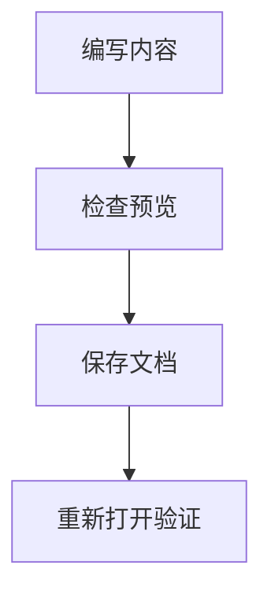

# 扩展语法、实际示例与排错

Markdown 的基础规则在不同编辑器之间较稳定，表格、任务清单、公式和图表属于需要确认支持范围的功能。写作时应同时检查编辑预览与保存后的阅读页面。预览正确、保存后错误的文章仍然需要修正，不能只交付原文截图。

## 基础语法和扩展语法

标题、段落、列表、引用、链接与代码块属于常用基础能力。表格、删除线、任务清单等扩展可查阅 [GFM 规范](https://github.github.com/gfm/)。基础语法可查阅 [CommonMark 规范](https://spec.commonmark.org/)。其他网站的专有提示框、折叠语法或自定义组件不能直接照搬，应先在本系统预览。

## 行内公式

系统使用数学渲染工具显示公式。行内公式使用同一行中的双美元符号包围数学表达式，适合放在段落中的变量和简单关系。本系统不把单美元符号识别为公式，命令变量和普通价格可以保持原文显示。

```markdown
圆的面积为 $$A = \pi r^2$$。
```

显示结果：圆的面积为 $$A = \pi r^2$$。公式只是展示文字，不会计算半径或自动更新数值。需要表达实际测量值时，在说明中同时写明单位和取值来源。

## 独立公式

一对双美元符号分别单独占行，用于独立展示较长公式。前后保留空行，避免与相邻段落混在一起。

```markdown
$$
E = mc^2
$$
```

显示结果：

$$
E = mc^2
$$

公式无法显示时，检查结束标记、反斜杠命令以及花括号是否配对。不要把公式命令写入普通代码块后期待它被执行，代码块的用途就是显示原文。

## Mermaid 流程图

使用语言名称为 `mermaid` 的围栏代码块描述流程。节点使用简短且唯一的英文标识，显示文字可以使用中文。连接线表达真实执行关系，不要只画装饰性的框。

````markdown

````

实际流程：


图表出错时，先用两个节点和一条连接线确认最小示例，再逐段增加节点。节点文字包含引号或复杂符号时，按 Mermaid 的语法使用明确的引号包围文本。不要让流程图替代必须写明的操作步骤。

## 代码块不等于可执行程序

普通语言名称只负责高亮，系统不会执行代码。命令示例应给出使用前提、输入位置和成功现象。涉及修改数据的命令还应说明目标范围，避免读者复制后误改其他项目。敏感信息应由实际运行配置提供，不写进可公开文档。

## HTML 与显示限制

系统会处理 Markdown 中的 HTML，并限制不适合直接显示的内容。脚本、内联事件或任意嵌入页面不能作为可依赖的写作方式。需要表达复杂结构时，优先使用系统已支持的标题、列表、表格、公式和图表。保存后实际显示的内容才是读者看到的结果。

## 可以直接使用的排错记录模板

下面的结构适合记录一次故障。每一项填写可观察事实，避免只写“异常”“修好了”等没有核对价值的描述。

````markdown
# 故障记录

## 现象

记录触发动作、页面提示和出现时间。

## 影响范围

说明受影响的功能和使用者。

## 复现步骤

1. 打开指定页面。
2. 执行明确动作。
3. 记录实际结果。

## 处理动作

说明修改的具体项目及原因。

## 验证

- [ ] 重新执行触发动作。
- [ ] 检查保存后的数据。
- [ ] 检查相关链接和附件。
````

## 按现象定位语法错误

整篇后半部分都显示为代码，通常是代码围栏没有闭合。列表跳出层级，检查普通空格和缩进。表格多出一列，检查单元格中的竖线是否转义。链接文字出现却无法点击，检查圆括号是否闭合及地址是否含未编码空格。图片显示替代文字，直接打开图片地址确认文件存在与访问权限。

## 检查跨设备显示

在较窄窗口中查看表格和代码块，确认内容能完整访问。检查长链接不会把操作入口挤出页面。截图需要在真实阅读页面生成，编辑器中的源码排得整齐不能证明最终显示正确。切换浅色与深色主题，检查图片内的文字和图表连接线仍清楚。

## 完成一篇文档的验收

保存并重新打开，逐项点击导航、内部链接、外部引用与图片。检查公式和流程图实际渲染，确认不存在原始错误提示。对于多篇教程，按阅读顺序逐篇跳转一遍，再从每篇返回相关内容。发现问题后修正文档，再重新执行对应检查，直到读者能够直接照着完成目标。


## 继续阅读

[写作流程](/markdown-getting-started) · [文本与代码](/markdown-text-and-code) · [列表与引用](/markdown-lists-and-structure) · [链接、图片与表格](/markdown-links-images-and-tables) · [扩展与排错](/markdown-extensions-and-troubleshooting)
