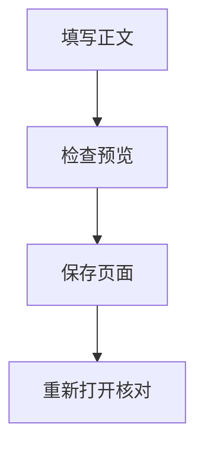

# 扩展语法、实际示例与排错

## 任务表格与删除线

预览支持 GFM 表格、任务列表和删除线。它们只是正文表示方式，不会自动创建后台任务或更改系统配置。

```markdown
- [x] 检查登录
- [ ] 检查附件

~~旧入口~~，请使用当前入口。
```

## 数学与图示

数学表达式交给 KaTeX 呈现。块级公式使用双美元围栏。单个美元符号不会作为行内数学起始标记处理，因此价格文字无需改写为公式。

$$
a^2+b^2=c^2
$$

Mermaid 围栏用于画流程图。图中的文字只是示意，不会执行对应操作。


## HTML 与安全边界

预览会解析 HTML，再执行清理。脚本和不在允许范围内的属性不能当作可靠的文章能力。不要把任意 HTML、任意样式或 JavaScript 运行描述为编辑器功能。使用标准 Markdown 表达内容，减少对浏览器差异的依赖。

## 排查显示问题

标题未生效时检查井号后的空格。整段变成代码时检查围栏是否闭合。表格错列时检查竖线。图片不显示时检查资源地址和读取权限。图示解析失败时先把图缩减为两个节点、一条连线，确认基础语法后再增加内容。预览正确后保存，再重新打开页面核对持久化内容。

## 公式应当同时具有文字解释

数学表达式用于准确呈现变量关系，正文仍应说明每个变量表示什么以及单位是什么。行内公式适合放在一句话中，块级公式适合独立展示较长关系。公式显示正常并不说明计算结果已经被系统验证，文档作者仍需核对推导和输入数值。价格、金额和普通美元符号不应误写成公式围栏，避免让一整段普通文字被当成数学内容。

下面的行内示例表示勾股关系，使用预览所支持的显式行内分隔写法：$$a^2+b^2=c^2$$。写公式时保持起止标记成对，命令拼写采用 KaTeX 支持的范围。遇到无法显示的表达式，先缩减成一个变量或一次加法，确认基础输入可用后再逐步恢复。不要将外部软件专用的表达式直接当作网页预览必然支持的语法。

## 按最小示例定位图示错误

流程图适合展示步骤之间的关系，节点名称应直接表达动作或状态。先画两个节点并连接，再加入成功和失败分支，能够更快发现拼写错误和标记冲突。复杂图应拆成几幅有明确主题的小图，避免在一个画面里混入用户操作、数据库结构和网络部署等不同层次。图示的文字需要与正文一致，不能出现正文要求先保存、图中却先关闭页面的矛盾。

下面的图示展示一个可检查的保存过程，读者可以把每个节点对应到实际界面动作。它仅描述关系，不会替用户提交数据，也不会自动确认保存结果。



## 区分输入问题与运行故障

排查时先保留能够复现问题的最小正文和实际现象。某个标题没有显示层次，检查井号和空格；后续段落全部显示为代码，检查围栏是否闭合；图片显示空白，检查地址与读取权限；保存按钮返回失败，检查网络、身份与服务器反馈。不要把所有问题都归结为语法错误，也不要在没有证据时反复重装系统。记录输入和结果，才能判断问题发生在哪一个环节。

涉及 HTML 时，应以清理后的最终预览为准。脚本、事件属性和任意样式不能当作文档功能使用，依赖它们的示例在安全处理后不会保留原行为。需要交互效果时使用系统已经提供的编辑与阅读能力，避免向正文嵌入未知代码。修复后重新预览、保存并再次打开同一篇页面，核对公式、图示、链接和附件都仍然存在。需要多人协助时，只分享必要的示例与错误信息，隐去账号凭据和私有内容。

## 教程导航

- [Markdown 入门与完整写作流程](/markdown-getting-started)
- [标题、文本格式与代码](/markdown-text-and-code)
- [列表、引用与内容组织](/markdown-lists-and-structure)
- [链接、图片与表格](/markdown-links-images-and-tables)
- [扩展语法、实际示例与排错](/markdown-extensions-and-troubleshooting)
